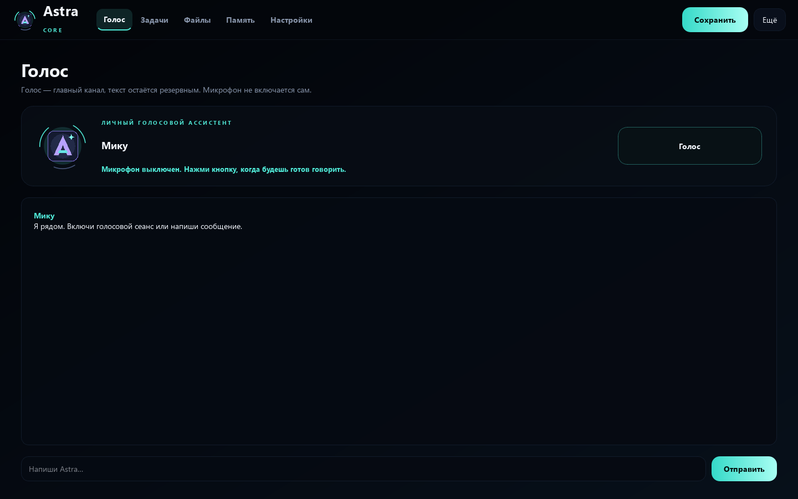

# Astra Voice Assistant

**Личный голосовой помощник для Windows 10 и 11.**

Astra помогает запускать приложения, управлять окнами и музыкой, искать файлы и ставить напоминания. В настольном приложении голос находится на первом месте, а текстовый чат доступен в том же окне.

[Запуск без Python](#запуск-без-python) · [Запуск из исходников](#запуск-из-исходников) · [Команды](#что-попробовать) · [Документация](docs/) · [Дорожная карта](docs/ROADMAP.md)



## Запуск из исходников

Установите Python 3.12 для Windows. В папке проекта один раз выполните эти команды в командной строке Windows:

```bat
py -3.12 -m venv .venv
.venv\Scripts\python.exe -m pip install -r requirements-desktop.txt
```

Затем откройте [start_astra_app.vbs](start_astra_app.vbs) двойным щелчком. В разделе **Голос** можно сразу написать команду или явно включить микрофон. Крестик сворачивает Astra в фон. Для выхода используйте **Ещё → Полностью выйти** или меню в системном трее.

## Запуск без Python

Распакуйте portable ZIP целиком и запустите `Astra.exe` двойным щелчком. На компьютере пользователя не нужны Python, PowerShell или виртуальное окружение. Не переносите один `Astra.exe` отдельно от `_internal`, `runtime`, `config` и `assets`. Персонажи в пакете остаются 2D; экспериментальная процедурная 3D-сцена пока не включается.

Для сборки из исходников разработчику нужны Python 3.12 и зависимости проекта. Команда `.venv\Scripts\python.exe tools\build_desktop.py` создаёт автономный ZIP; по умолчанию результат сохраняется в `D:\AstraBuild`. Настройки Astra хранятся отдельно от сборки в `%LOCALAPPDATA%\AstraVoiceAssistant`; личный `.env` в пакет не попадает.

## Что попробовать

| Скажите или напишите | Что сделает Astra |
| --- | --- |
| «Астра, который час?» | Ответит по местному времени. |
| «Астра, открой браузер» | Выберет браузер по настройкам и регистрации в Windows. |
| «Астра, следующий трек» | Отправит команду медиаплееру. |
| «Астра, напомни через 10 минут сделать перерыв» | Создаст напоминание. |

Вместо «Астра» используйте имя выбранного персонажа, если меняли его. Доступ к документам ограничен выбранными папками. Запуск впервые обнаруженного приложения требует подтверждения. Провайдера ИИ можно выбрать в настройках. Обычные команды времени, окон и медиа работают без подключения модели.

## Разработка

Версия исходников — **3.1.0**. Qt-приложение и отдельный runtime Astra собраны вместе в переносимый 2D-пакет; на целевой Windows он прошёл проверку запуска в offscreen-режиме и автоматические проверки состава. Реальная визуальная и голосовая приёмка остаётся открытой, поэтому это ещё не стабильный выпуск. Состояние функций и оставшиеся проверки описаны в [документации](docs/README.md).

```bat
powershell.exe -NoProfile -ExecutionPolicy Bypass -File tools\run_current_gate.ps1
```

GitHub Actions проверяет изменения в pull request и в `main`. Сборку Windows-пакетов запускают отдельно через **Actions → Windows checks → Run workflow** с параметром **Build and verify portable and installer packages**. Уведомления о компонентах и их лицензиях собраны в [THIRD_PARTY_NOTICES.md](THIRD_PARTY_NOTICES.md).
